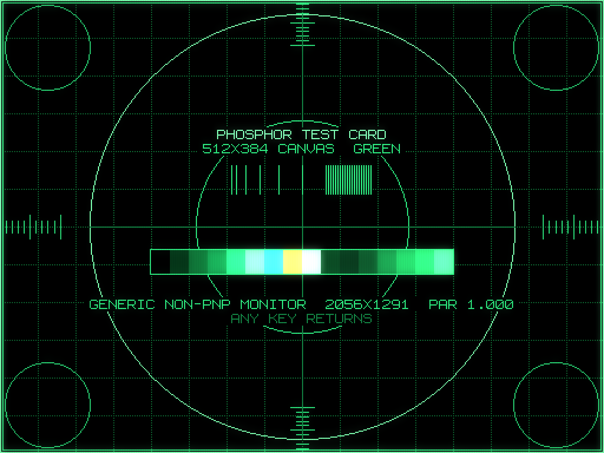
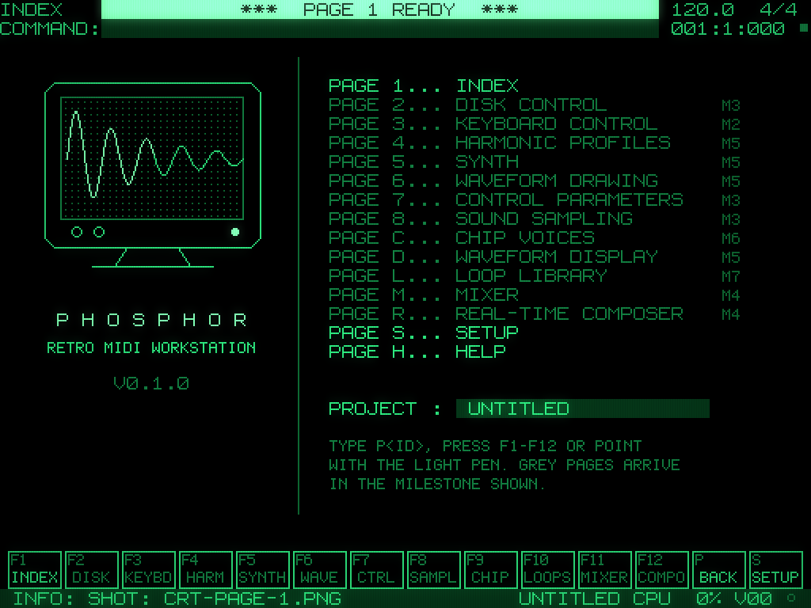
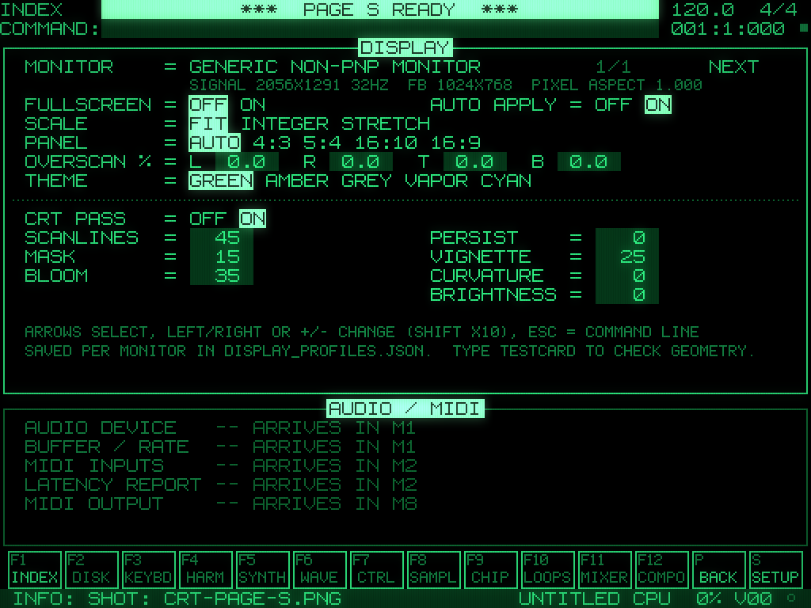

  

<h1 align="center">PHOSPHOR</h1>

A retro MIDI workstation with a green-phosphor CRT interface: page-based, keyboard commands, mouse as a light
pen. It renders into a fixed 512 × 384 indexed canvas and upscales through a CRT pass, so it shows correctly
on a small 4:3 monitor.

Status: **M0 (bootstrap and display)**. Window, CRT pass, display profiles, command line, pages 1 / S / H and the
test card. No audio yet.

## Screenshots

Captured from the running app with the CRT pass on (`SHOT`).

| Page 1 — Index | Page S — Setup |
|---|---|
|  |  |

## Build

Requirements: CMake ≥ 3.24, Ninja, a C++20 compiler (Apple clang on macOS 13+, MSVC 2022 on Windows), network
access on first configure (dependencies are fetched and pinned, see [docs/deps.md](docs/deps.md)).

macOS:

    cmake --preset mac-debug && cmake --build --preset mac-debug
    ctest --preset mac-debug
    ./build/mac-debug/phosphor

Windows (from a "x64 Native Tools" prompt, or prefix each command with `tools\win\dev.cmd`):

    cmake --preset win-debug && cmake --build --preset win-debug
    ctest --preset win-debug
    build\win-debug\phosphor.exe

## Use

Type commands on the COMMAND line (`HELP`, `P1`, `PS`, `THEME AMBER`, `TESTCARD`, `DISPLAY NEXT` …), use
F1–F12 for pages, or point and click with the mouse. Settings live in `~/Library/Application Support/Phosphor/`
or `%APPDATA%\Phosphor\` (`display_profiles.json`, optional `keys.cfg`; examples in `conf/`).

Setting up a 4:3 monitor: move the window there (`DISPLAY NEXT`), open Page S, set FULLSCREEN ON, and if the
panel squashes a 16:9 signal set PANEL 4:3. Run `TESTCARD` and adjust OVERSCAN until the outer frame touches
the bezel and the circle is round. The profile is stored under the monitor's name and re-applied when it
reconnects.

Headless render (no window, used by golden tests):

    phosphor --headless --render-page S --out page-s.png [--theme AMBER]

Scripted run (one command per frame; `SNAP` saves the canvas, `SHOT` the CRT output):

    phosphor --exec "PS" --exec "WAIT 20" --exec "SHOT s.png" --exec QUIT
