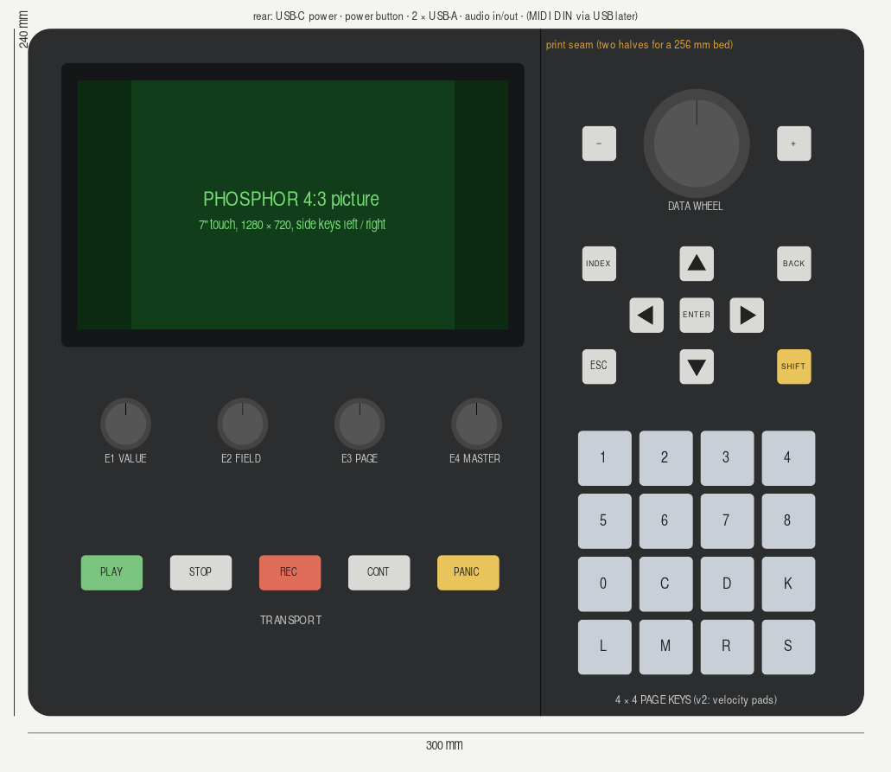

# PHOSPHOR prototype device: concept

Status: concept for M9 (2026-11-27). Decisions marked ★ are yours. Where you haven't decided yet, a
default is chosen and labelled as an assumption, so work can start.

## 1. What it is

A standalone desktop instrument: PHOSPHOR on a Raspberry Pi 5, in a 3D-printed case, with a 7" touch
screen, hardware keys for navigation and values, four endless encoders, a data wheel, transport keys
and a 4 × 4 key grid. USB MIDI keyboards plug in at the back. Audio goes through a USB audio interface.
Power on → PHOSPHOR, power button → clean shutdown.

Version 1 is a prototype: hand-wired controls on perfboard, a printed case, off-the-shelf modules. A
custom circuit board and velocity pads come in version 2, once v1 has proved the layout.



Source drawing: [panel-layout.svg](panel-layout.svg) (1 unit = 1 mm).

## 2. Front panel and what each control does

The keys send the same actions as the on-screen side keys and the computer keyboard, so every page
works without a keyboard and nothing new has to be learned.

| Group | Controls | Action in PHOSPHOR |
|---|---|---|
| Screen | 7" touch, 1280 × 720 | 4:3 picture (960 × 720) plus side keys in the margins; touch = light pen |
| Data wheel | 1 large knob (no detents) | + / − on the focused field (fast turn = bigger steps) |
| + / − | 2 keys | + / − (hold repeats) |
| Cursor | ▲ ▼ ◄ ► ENTER | arrow keys and ENTER |
| Navigation | INDEX, BACK, ESC | Page 1, previous page, ESC (fields → command line) |
| SHIFT | 1 key | modifier: big steps (SHIFT + wheel), second functions (SHIFT + grid = pads mode) |
| Encoders | E1–E4, endless, with push | E1 value (as the wheel), E2 field up / down, E3 page < / >, E4 master level; push = ENTER / ESC / INDEX / PANIC |
| Transport | PLAY, STOP, REC, CONT, PANIC | the commands of the same names |
| 4 × 4 grid | 16 keys | page keys 1–8, 0, C, D, K, L, M, R, S; SHIFT toggles to note keys (current instrument, like KEYJAZZ) |

HELP stays on the INDEX page and the H command; the grid has 16 slots and PHOSPHOR has 17 pages.

## 3. System

```
 ┌──────────────────────────── case ──────────────────────────────────────┐
 │ 7" Touch Display 2 ──DSI── Raspberry Pi 5 (4 GB) + active cooler        │
 │   (5 V from the Pi's header)      │USB      │USB          │USB-C power   │
 │                                   │         │             │              │
 │ controls board: Pico 2 ───────────┘   USB audio       panel USB-C  ◄── 27 W supply
 │  key matrix 6 × 6, 4 encoders,        interface       power button ── Pi 5 J2
 │  data wheel (magnetic), LEDs          (in / out)      2 × USB-A on the back
 └────────────────────────────────────────────────────────────────────────┘
```

- **Raspberry Pi 5, 4 GB.** About 2–3× the CPU of a Pi 4, which matters for STRETCH, the plate reverb and
  32 voices. It has a power-button header (J2). It has no analog audio output.
- **Raspberry Pi Touch Display 2, 7".** 1280 × 720, 5-point touch, DSI, powered from the Pi, in
  production until at least 2030. Active area 154.6 × 86.9 mm. The 5" version has the same resolution
  (active area 110.4 × 62.1 mm) and would make the case about 50 mm narrower.
- **Controls board: Raspberry Pi Pico 2 (RP2350), or the original Pico.** It is a USB-MIDI device. It scans
  the keys, reads the encoders and the wheel, and drives the LEDs. The Pi needs no special drivers, and the
  same board also works with PHOSPHOR on the Mac.
- **Audio: a class-compliant USB interface.** Assumption ★: 2 in / 2 out, bus-powered, mounted inside, with
  its jacks reached through the back panel or on short panel-mount extensions.

## 4. Controls board

**Pin budget (Pico 2: 26 GPIO)**

| Use | Pins |
|---|---|
| Key matrix 6 rows × 6 columns (30 keys + 4 encoder pushes + 2 spare), one 1N4148 diode per key | 12 |
| Encoders E1–E4 (EC11-type, quadrature A / B) | 8 |
| Data wheel: AS5600 magnetic angle sensor + magnet in the wheel hub, I2C | 2 |
| LEDs: one chain of addressable RGB LEDs under the transport keys and the grid | 1 |
| Spare | 3 |

**USB-MIDI messages** (channel 16, so a MIDI keyboard on channels 1–15 never collides):

| Control | Message |
|---|---|
| Keys (grid 0–15, cursor / navigation 16–24, transport 25–29, encoder pushes 30–33) | Note On (velocity 127) / Note Off, note = key number |
| Encoders E1–E4 | CC 16–19, relative: 65–127 = +1…+63, 63–1 = −1…−63 |
| Data wheel | CC 20, relative, as above, with acceleration in the firmware |
| LEDs (from PHOSPHOR) | Note On on channel 16 back to the board: note = LED, velocity = colour index |

PHOSPHOR gets a `SURFACE` mapping (M9) from these messages to its own actions. That covers the default
above, plus a learn mode if you rearrange the panel.

## 5. Parts list (rough prices, late 2026, EUR)

| Part | Qty | ≈ € |
|---|---|---|
| Raspberry Pi 5, 4 GB | 1 | 65–80 |
| Active cooler for Pi 5 | 1 | 5 |
| 27 W USB-C power supply (5.1 V / 5 A) | 1 | 12 |
| Touch Display 2, 7" | 1 | 60 |
| microSD 64 GB (A2) or NVMe via M.2 HAT (optional) | 1 | 10 (NVMe +40) |
| Raspberry Pi Pico 2 | 1 | 5 |
| Key switches, MX-compatible, with caps (relegendable caps for the grid) | 30 | 30–45 |
| 1N4148 diodes, perfboard, wire, headers | — | 10 |
| EC11 encoders with push + knobs | 4 | 12 |
| AS5600 board + diametric magnet + 6 mm shaft bearing + wheel knob | 1 | 15 |
| Addressable RGB LEDs (reverse-mount, for MX switches) | 21 | 8 |
| USB audio interface, class-compliant, 2 in / 2 out | 1 | 40–100 |
| Panel-mount USB-C (power), 2 × USB-A extensions, power button | — | 20 |
| Filament (PETG or ASA), about 1.5 kg | — | 35 |
| M3 brass heat-set inserts, M3 screws, rubber feet | — | 15 |
| **Total** | | **≈ 340–470** |

## 6. Enclosure

- **Size:** 300 × 240 mm. The top slopes about 8°, from 32 mm at the front to 65 mm at the back, so the
  display tilts towards you.
- **Printing:** most beds are ≤ 256 mm, so the case prints in two halves (seam between the display and the
  right-hand block, dashed in the drawing). The halves join with printed alignment tongues and M3 screws
  into brass inserts. The bottom is a separate tray (also two halves) carrying the Pi, the interface and
  the cable routing.
- **Alternative top:** a laser-cut 3 mm aluminium or acrylic top plate in one piece, ordered from a cutting
  service, on a printed frame. It is stiffer and looks better around the keys; worth it for v1.1.
- **Material:** PETG (easy) or ASA (more heat- and UV-resistant). The Pi 5 under load warms the case, so
  PLA would soften near it.
- **Fixings:**
  - Keys sit in a 1.5 mm plate layer: MX switches clip into 14 mm square cut-outs.
  - Encoders mount with their nuts.
  - The display mounts with its own M2.5 holes on printed standoffs.
- **Cooling:** an intake slot under the front edge and an exhaust grille at the back, near the Pi's fan.
- **Back panel:** USB-C power, power button, 2 × USB-A (USB stick, MIDI keyboard), the audio jacks; later
  MIDI DIN through a USB-MIDI adapter inside.
- **Source:** parametric OpenSCAD in `hardware/case/`, every size in one file, so the 5" display or another
  printer bed is a parameter change. STL exports go next to it.

## 7. Software on the device (M9)

- **OS:** Raspberry Pi OS Lite, 64-bit. PHOSPHOR starts as a systemd service, fullscreen, with no desktop.
- **Graphics:** OpenGL ES 3.1 (the Pi's driver offers GL 3.1 / GLES 3.1, not the GL 3.3 core used on macOS),
  so the CRT shaders get an ES variant.
- **Window layer:** this is D1 of `docs/porting-mobile.md`, and the device makes it urgent. SDL3 draws
  without a desktop (KMS/DRM); GLFW needs a small Wayland compositor (`cage`) underneath. Recommendation:
  SDL3.
- **Audio:**
  - ALSA through miniaudio.
  - Real-time thread priority and the `performance` CPU governor.
  - 128-frame buffers to start, measured with `--latency-report` as on the Mac.
- **Shutdown:**
  - The power button (J2) asks the OS to shut down; PHOSPHOR autosaves on SIGTERM.
  - Optional read-only root file system, so pulling the plug cannot corrupt the SD card.
- **Layout:** the side keys appear automatically on the 16:9 panel (AUTO): 85 canvas px per side, so the
  on-screen keys are about 17 × 16 mm on the 7" panel.

## 8. Phases

| Phase | What | You | Me | Done when |
|---|---|---|---|---|
| 1 | Concept (this document) | read, decide ★ | write | decisions made |
| 2 | Software on a bare Pi 5 + display + USB audio, USB keyboard as stand-in | set up the Pi, run tests | Linux / GLES / kiosk code, scripts | PHOSPHOR boots fullscreen, `ctest` green on the Pi, latency measured |
| 3 | Controls on a breadboard: Pico, a few keys, one encoder, the wheel | wire it, flash | firmware, `SURFACE` mapping | every action reachable from the controls |
| 4 | Case test prints: one panel corner with a key, an encoder, the display mount | print, report fit | OpenSCAD model | parts fit within 0.2 mm |
| 5 | Full build: case, perfboard controls, assembly | build | wiring diagram, assembly notes, fixes | M9 acceptance criteria (PLAN.md) |
| 6 (v2) | Custom PCB (KiCad), velocity pads | order, solder | schematic, layout help | — |

## 9. Assumptions and open decisions (★)

| # | Question | Assumed for now |
|---|---|---|
| ★ H1 | Pads: velocity-sensitive pads (force sensors, more work) or keys? | v1: the 4 × 4 key grid (page keys, SHIFT = notes); v2: velocity pads |
| ★ H2 | Audio: USB interface or a codec board on the Pi (more integrated, more setup)? | USB interface inside the case |
| ★ H3 | Display: 7" or 5"? | 7" |
| ★ H4 | Printer bed size, and can you solder through-hole parts? | 256 × 256 mm; yes |
| ★ H5 | Budget | ≈ 400 € |
| ★ H6 | The device's name (its own, not a trademark of another maker) | "PHOSPHOR" for now |
| ★ D1 | Window layer (from the mobile plan): SDL3 or GLFW + `cage` | SDL3 |

## 10. Risks

- **Pi audio latency:** USB audio on Linux is usually fine at 128 frames, but it varies by interface. We'll
  measure early (phase 2) before the case is designed around one.
- **Heat:** the Pi 5 throttles at about 85 °C. The active cooler and the vent path matter more in a closed
  case; we'll check with `vcgencmd measure_temp` under load.
- **Print tolerances:** key cut-outs and encoder holes differ by printer. That's why phase 4 prints test
  pieces before the full case.
- **Data wheel feel:** a magnetic sensor gives a smooth wheel with no detents, but needs a bearing and a
  centred magnet. Fallback: a 24-step encoder with a large knob.
